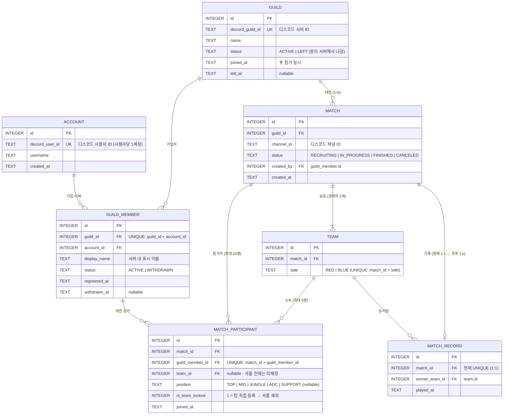

# 프로젝트 개요

디스코드 채팅방 내에서 5대5 게임 대전을 관리할 디스코드 커스텀 봇 개발

## 개발 요건

- 대전을 조율 및 관리해줄 디스코드 봇을 생성한다.
- 봇은 자동 또는 수동(입력되는 명령어)으로 작업을 수행한다.
- 구조: **계정관리 서비스**(서비스 이용 자격 관리) + **대전관리 서비스**(대전별 등록 및 팀 섞기)

### 1. 계정관리 서비스
- **계정 등록**: 커맨드로 아이디별 계정을 등록한다.
- **계정 탈퇴**: 커맨드로 계정을 탈퇴한다.

### 2. 대전관리 서비스
사용자 관리 / 팀 관리 / 개인별 승점 조회

#### 2-1. 사용자 관리
- **대전 등록**: 커맨드로 이번 대전에 참가한다.
- **대전 탈퇴**: 커맨드로 대전 참가를 철회한다.
- **포지션 선택**: 커맨드로 탑/미드/정글/원딜/서폿 중 하나를 선택한다.

#### 2-2. 팀 관리
- **팀 등록**: 커맨드로 원하는 팀을 선택한다.
- **팀 탈퇴**: 커맨드로 팀에서 탈퇴한다.
- **팀 자동셔플**: 대전에 10명이 등록되어 있을 때만 사용 가능하며, 랜덤으로 팀을 섞어 정해준다.
  - 개인에게 포지션이 등록되어 있다면 포지션을 우선으로 고려한다.
  - 개인이 팀 등록을 미리 했다면 해당 인원은 셔플 대상에서 제외한다(선택한 팀 유지).

#### 2-3. 개인별 승점 조회
- 사용자별 승점을 조회할 수 있다.
- **승점 규칙: 1승당 1점, 감점 없음** (서버별로 따로 계산)

### 확정된 운영 규칙
- **서버당 진행 중인 대전은 1개만** 허용한다. (`RECRUITING`/`IN_PROGRESS` 상태는 서버당 1개, DB의 부분 UNIQUE 인덱스로도 보장)
- 대전 상태 흐름: `RECRUITING`(모집 중) → `IN_PROGRESS`(진행 중) → `FINISHED`(종료), 언제든 `CANCELED`(취소) 가능
- 대전 시작·결과 기록·취소는 **대전을 만든 사람 또는 서버 관리자(서버 관리 권한)**만 할 수 있다.
- 참가자 변경(대전 참가/탈퇴, 팀 등록/탈퇴)이 생기면 기존 셔플 결과(직접 등록자 제외)는 초기화되므로 다시 셔플해야 한다.

## 기술 스택

- **Runtime**: Node.js
- **Discord 라이브러리**: discord.js
- **DB**: SQLite

## 데이터베이스 설계 (RDB)

### 설계 원칙

- DB는 **SQLite 파일 1개**를 모든 디스코드 서버가 함께 쓰고, **서버(guild) 단위로 데이터를 논리적으로 분리**한다.
- 기본 흐름: **서버(guild) - 계정(account) - 대전(match) - 팀(team) - 대전기록(match_record)**
- **계정은 디스코드 사용자당 1개** (`account.discord_user_id` UNIQUE)
- **서버 ↔ 계정 = N:M**: 한 사람이 여러 서버에 가입할 수 있다. 연결 테이블은 **서버회원(guild_member)**이며, `UNIQUE(guild_id, account_id)`로 서버당 1회만 가입할 수 있다.
  - 커맨드의 "계정 등록/탈퇴"는 **해당 서버의 guild_member 등록/탈퇴**를 뜻한다. `account`는 처음 등록할 때 자동으로 만들어진다.
  - 그래서 A 서버에서 탈퇴해도 B 서버의 가입과 승점에는 영향이 없다.
- **서버 ↔ 대전 = 1:N**: 대전은 반드시 하나의 서버에 속하고, 서버마다 대전을 여러 개 만들 수 있다.
- 대전마다 팀은 **2개**, 기본값은 **레드팀(RED) / 블루팀(BLUE)** (`UNIQUE(match_id, side)`)
- **대전 ↔ 서버회원 = N:M**이므로 **대전참가자(match_participant)**로 풀어낸다. 참가자는 `guild_member`를 참조하므로 **해당 서버에 가입한 사람만** 대전에 참가할 수 있다.
- 대전기록은 현재 대전과 **1:1** (`match_record.match_id` UNIQUE). 이후 요구사항이 바뀌면 **1:n**으로 확장 (UNIQUE 제약만 제거)

### ERD



### 테이블 설명

| 테이블 | 역할 | 주요 제약 |
|---|---|---|
| `guild` | 봇이 참가한 디스코드 서버 | `discord_guild_id` UNIQUE. 봇이 서버에 들어올 때(`guildCreate` 이벤트) 자동 생성하고, 나갈 때(`guildDelete`) `status = LEFT`로 바꾼다 |
| `account` | 디스코드 사용자 (전역) | `discord_user_id` UNIQUE. 사용자당 1개 |
| `guild_member` | 서버별 가입 정보 (계정 등록/탈퇴) | `UNIQUE(guild_id, account_id)`. 탈퇴하면 `status = WITHDRAWN`으로 바꾸는 soft delete (기록 보존용). 다시 가입하면 같은 행을 `ACTIVE`로 되돌린다 |
| `match` | 대전 1건 | `guild_id` NOT NULL. `status`로 모집 → 진행 → 종료 상태를 관리 |
| `team` | 대전의 팀 (RED/BLUE) | 대전을 만들 때 2개를 자동 생성. `UNIQUE(match_id, side)`, `side IN ('RED','BLUE')` |
| `match_participant` | 대전 참가자 (대전 등록/탈퇴, 포지션 선택, 팀 등록/탈퇴) | `UNIQUE(match_id, guild_member_id)`. 대전당 10명, 팀당 5명 제한, 참가자가 대전과 같은 서버 회원인지는 애플리케이션에서 검증 |
| `match_record` | 대전 결과 | 현재 `match_id` UNIQUE (1:1) |

### 기능 ↔ 테이블 매핑

- **봇 서버 참가 / 퇴장** → `guild` INSERT(또는 `ACTIVE`로 복구) / `status = LEFT`
- **계정 등록** → `account`가 없으면 INSERT → `guild_member` INSERT(또는 `ACTIVE`로 복구)
- **계정 탈퇴** → 해당 서버의 `guild_member.status = WITHDRAWN` (다른 서버 가입에는 영향 없음)
- **대전 등록 / 탈퇴** → `match_participant` INSERT / DELETE (`ACTIVE` 상태의 guild_member만 가능)
- **포지션 선택** → `match_participant.position` UPDATE
- **팀 등록 / 탈퇴** → `match_participant.team_id` 설정 + `is_team_locked = 1` / `team_id = NULL` + `is_team_locked = 0`
- **팀 자동셔플** → 참가자가 10명인지 확인 → `is_team_locked = 0`인 참가자만 대상으로, 포지션이 겹치지 않도록 우선 배치한 뒤 나머지를 랜덤으로 `team_id` 배정
- **개인별 승점 조회** → `guild_member` 기준으로 `match_participant.team_id`와 `match_record.winner_team_id`를 JOIN해서 **서버별로** 계산 (승점 규칙은 추후 확정)

### 구현 시 주의

- 모든 조회와 변경은 **현재 커맨드가 들어온 서버(guild) 범위**로 한정한다. 다른 서버의 데이터가 섞이지 않도록 서비스 계층에서 `guild_id` 조건을 강제한다.

### 확장 메모 (대전기록 1:n 전환 시)

- `match_record.match_id`의 UNIQUE 제약을 제거한다.
- 판마다 팀 구성이 바뀔 수 있다면, 판별 팀 배정을 저장하는 `record_participant(record_id, guild_member_id, team_id, position)` 테이블을 추가하는 방안을 검토한다.

## 슬래시 커맨드

| 커맨드 | 설명 | 비고 |
|---|---|---|
| `/계정 등록` | 이 서버에 계정 등록 | 탈퇴했다가 다시 등록하면 이전 기록이 이어짐 |
| `/계정 탈퇴` | 이 서버에서 계정 탈퇴 | 모집 중인 대전에 참가 중이면 대전에서도 빠짐. 진행 중인 대전 참가자는 탈퇴 불가 |
| `/대전 생성` | 새 대전 열기 | 서버당 1개 |
| `/대전 참가` | 이번 대전 참가 | **[자동]** 대전이 없으면 새로 만듦. **[자동]** 10명이 모이면 셔플 안내 |
| `/대전 탈퇴` | 대전 참가 철회 | 모집 중일 때만 |
| `/대전 포지션 <포지션>` | 탑/정글/미드/원딜/서폿 선택 또는 해제 | |
| `/대전 참가자` | 참가자 목록 보기 (참가 순서, 포지션, 팀) | `/대전 참가` 응답에도 목록 표시 |
| `/대전 현황` | 현재 대전 참가자와 팀 구성 보기 | |
| `/대전 시작` | 10명, 5:5 구성이 끝난 대전 시작 | 대전 생성자/서버 관리자 |
| `/대전 결과 <승리팀>` | 결과 기록, 승리팀 전원 승점 +1 | 대전 생성자/서버 관리자 |
| `/대전 취소` | 대전 취소 | 대전 생성자/서버 관리자 |
| `/팀 등록 <레드팀/블루팀>` | 원하는 팀 직접 선택 (셔플 제외) | 팀당 최대 5명 |
| `/팀 탈퇴` | 팀에서 빠지기 (다시 셔플 대상) | |
| `/팀 셔플` | 10명일 때 팀 자동 배정 | 포지션 겹침이 가장 적은 배치 중 랜덤 |
| `/승점 조회 [사용자]` | 개인 승점, 전적 조회 | |
| `/승점 랭킹` | 서버 승점 TOP 10 | |

자동 처리 이벤트: 봇이 켜질 때 참가 중인 서버를 동기화하고, 서버에 들어오거나 나갈 때 `guild` 상태를 갱신한다.

## 커맨드 로그 (`src/utils/commandLogger.js`)

- 모든 슬래시 커맨드 실행을 **서버별 텍스트 파일**에 한 줄씩 남긴다: `logs/<디스코드 서버 ID>.log` (서버 밖 DM은 `logs/direct-message.log`)
- 형식: `[등록날짜] 등록 커맨드 | 등록자 | 성공/실패 | 결과 메시지`
  ```
  [2026-11-20 15:30:12] /대전 포지션 포지션:MID | 홍길동 (hong, 123456789) | 성공 | 🎯 <@123456789> 님의 포지션: **미드**
  ```
  - 등록날짜: `LOG_TIMEZONE` 기준 (기본 Asia/Seoul)
  - 등록 커맨드: 서브커맨드와 옵션까지 포함
  - 등록자: 서버 표시 이름 (사용자명, 디스코드 ID)
  - 결과 메시지: 봇이 보낸 응답 (임베드는 `[임베드] 제목 설명`으로 요약, 줄바꿈은 ` / `로 치환)
- 로그 기록에 실패해도 커맨드 처리에는 영향을 주지 않는다. 로그 폴더는 `LOG_DIR`로 바꿀 수 있고 git에는 올리지 않는다.

## 팀 자동셔플 알고리즘 (`src/services/shuffle.js`)

1. 팀 직접 등록자(`is_team_locked = 1`)는 등록한 팀에 고정한다.
2. 나머지 인원으로 두 팀이 5명씩 되는 **모든 조합**을 만든다 (최대 C(10,5) = 252개).
3. 각 조합마다 팀 안에서 포지션이 겹치는 수를 계산해 (고정 인원 포함, 포지션 미선택자는 제외) 겹침이 **가장 적은** 조합만 남긴다.
4. 남은 후보 중 하나를 **무작위**로 고른다.

## 프로젝트 구조

```
src/
  index.js              # 봇 진입점 (이벤트, 커맨드 라우팅, 오류 응답)
  deploy-commands.js    # 슬래시 커맨드 등록 스크립트
  config.js             # 환경 변수 (.env)
  constants.js          # 인원, 포지션, 팀, 상태, 승점 상수
  db/schema.sql         # SQLite 스키마
  db/index.js           # DB 열기 + 스키마 적용
  repositories/         # 테이블별 쿼리 (SQL은 이 폴더에만 둔다)
    index.js            # createRepositories(db) + transaction(fn)
    guildRepository.js              # guild
    accountRepository.js            # account
    guildMemberRepository.js        # guild_member (+ 서버 승점 랭킹)
    matchRepository.js              # match
    teamRepository.js               # team
    matchParticipantRepository.js   # match_participant (+ 개인 전적)
    matchRecordRepository.js        # match_record
  services/             # 비즈니스 로직 (Repository만 호출, 디스코드와 독립, 테스트 대상)
    guildService.js     # 서버 등록/퇴장
    accountService.js   # 계정관리 (등록/탈퇴)
    matchService.js     # 대전관리 - 대전, 사용자 관리
    teamService.js      # 대전관리 - 팀 관리
    shuffle.js          # 팀 자동셔플 알고리즘 (순수 함수)
    pointService.js     # 대전관리 - 승점 조회
  commands/             # 슬래시 커맨드 정의 + 응답 (계정/대전/팀/승점)
  utils/                # UserError, Embed 포맷, 커맨드 로그
logs/                   # 서버별 커맨드 로그 (<서버 ID>.log, git 제외)
test/                   # node:test 기반 테스트 (npm test)
```

## 개발 규칙

- 계층 구조: `commands/` → `services/` → `repositories/` → DB
  - `commands/`: 입력 파싱과 응답 표시만 담당한다.
  - `services/`: 비즈니스 로직. **DB에 직접 쿼리하지 않고 Repository만 호출한다.**
  - `repositories/`: **테이블별 파일**(`<테이블>Repository.js`)에 SQL을 둔다. 여러 테이블을 JOIN하는 조회는 결과의 기준이 되는 테이블의 Repository에 둔다.
- 사용자에게 보여줄 오류는 `UserError`로 던진다. 커맨드 처리기에서 본인에게만 보이는(ephemeral) 메시지로 표시한다.
- 상태를 바꾸는 서비스 함수는 `repos.transaction(fn)`으로 감싼다.
- 모든 조회와 변경은 현재 서버(`guild.id`) 범위로 한정한다.
- 변경 후 `npm test`로 테스트를 확인한다.
