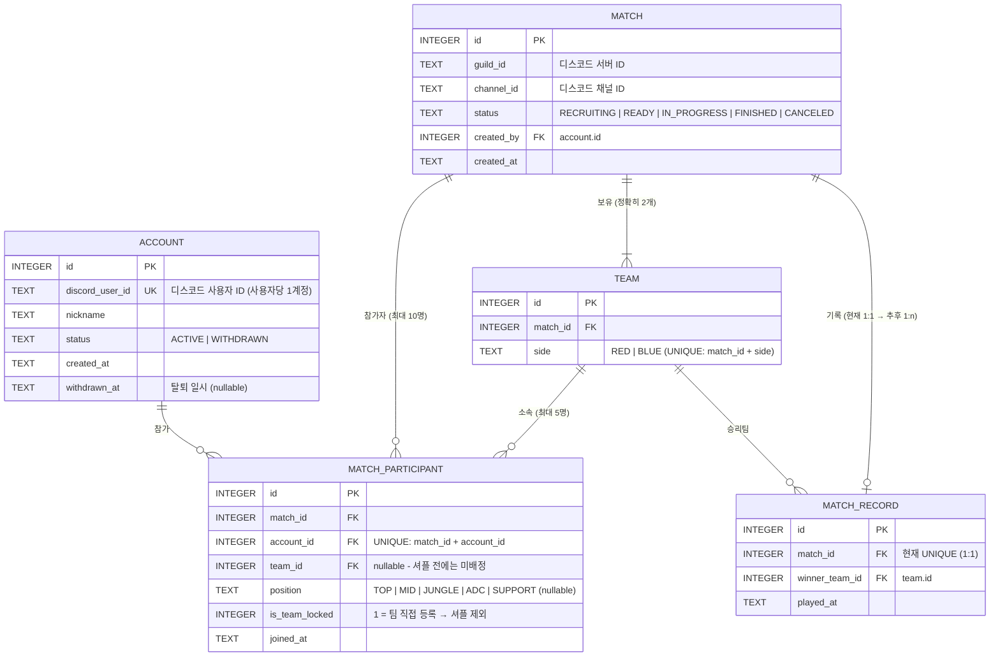

# 프로젝트 개요

디스코드 채팅방 내에서 5대5 게임 대전을 관리할 디스코드 커스텀 봇 개발

## 개발 요건

- 대전을 조율 및 관리해줄 디스코드 봇을 생성한다.
- 봇은 자동 또는 수동(입력되는 명령어)으로 작업을 수행한다.
- 구조: **계정관리 서비스**(서비스 이용 자격 관리) + **대전관리 서비스**(대전별 등록 및 팀 섞기)

### 1. 계정관리 서비스
- **계정 등록**: 커맨드로 아이디별 계정을 등록한다.
- **계정 탈퇴**: 커맨드로 계정을 탈퇴한다.

### 2. 대전관리 서비스
사용자 관리 / 팀 관리 / 개인별 승점 조회

#### 2-1. 사용자 관리
- **대전 등록**: 커맨드로 이번 대전에 참가한다.
- **대전 탈퇴**: 커맨드로 대전 참가를 철회한다.
- **포지션 선택**: 커맨드로 탑/미드/정글/원딜/서폿 중 하나를 선택한다.

#### 2-2. 팀 관리
- **팀 등록**: 커맨드로 원하는 팀을 선택한다.
- **팀 탈퇴**: 커맨드로 팀에서 탈퇴한다.
- **팀 자동셔플**: 대전에 10명이 등록되어 있을 때만 사용 가능하며, 랜덤으로 팀을 섞어 정해준다.
  - 개인에게 포지션이 등록되어 있다면 포지션을 우선으로 고려한다.
  - 개인이 팀 등록을 미리 했다면 해당 인원은 셔플 대상에서 제외한다(선택한 팀 유지).

#### 2-3. 개인별 승점 조회
- 사용자별 승점을 조회할 수 있다.

## 기술 스택

- **Runtime**: Node.js
- **Discord 라이브러리**: discord.js
- **DB**: SQLite

## 데이터베이스 설계 (RDB)

### 설계 원칙

- 기본 흐름: **계정(account) - 대전(match) - 팀(team) - 대전기록(match_record)**
- 계정은 **디스코드 사용자당 1개** (`account.discord_user_id` UNIQUE)
- 대전마다 팀은 **2개**, 기본값은 **레드팀(RED) / 블루팀(BLUE)** (`UNIQUE(match_id, side)`)
- 대전기록은 현재 대전과 **1:1** (`match_record.match_id` UNIQUE). 이후 요구사항이 바뀌면 **1:n**으로 확장 (UNIQUE 제약만 제거)
- 계정과 대전은 N:M 관계이므로 **대전참가자(match_participant)** 연결 테이블로 풀어낸다. 포지션·팀 선택 정보는 대전마다 달라지므로 이 테이블에 저장한다.

### ERD

### 테이블 설명

| 테이블 | 역할 | 주요 제약 |
|---|---|---|
| `account` | 서비스 이용 계정 (계정 등록/탈퇴) | `discord_user_id` UNIQUE. 탈퇴하면 `status = WITHDRAWN`으로 바꾸는 soft delete (과거 기록 보존용) |
| `match` | 대전 1건 | `status`로 모집 → 진행 → 종료 상태를 관리 |
| `team` | 대전의 팀 (RED/BLUE) | 대전을 만들 때 2개를 자동 생성. `UNIQUE(match_id, side)`, `side IN ('RED','BLUE')` |
| `match_participant` | 대전 참가자 (대전 등록/탈퇴, 포지션 선택, 팀 등록/탈퇴) | `UNIQUE(match_id, account_id)`. 대전당 10명, 팀당 5명 제한은 애플리케이션에서 검증 |
| `match_record` | 대전 결과 | 현재 `match_id` UNIQUE (1:1) |

### 기능 ↔ 테이블 매핑

- **계정 등록 / 탈퇴** → `account` INSERT / `status` UPDATE
- **대전 등록 / 탈퇴** → `match_participant` INSERT / DELETE
- **포지션 선택** → `match_participant.position` UPDATE
- **팀 등록 / 탈퇴** → `match_participant.team_id` 설정 + `is_team_locked = 1` / `team_id = NULL` + `is_team_locked = 0`
- **팀 자동셔플** → 참가자가 10명인지 확인 → `is_team_locked = 0`인 참가자만 대상으로, 포지션이 겹치지 않도록 우선 배치한 뒤 나머지를 랜덤으로 `team_id` 배정
- **개인별 승점 조회** → `match_record.winner_team_id`와 `match_participant.team_id`를 JOIN해서 계산 (승점 규칙은 추후 확정)

### 확장 메모 (대전기록 1:n 전환 시)

- `match_record.match_id`의 UNIQUE 제약을 제거한다.
- 판마다 팀 구성이 바뀔 수 있다면, 판별 팀 배정을 저장하는 `record_participant(record_id, account_id, team_id, position)` 테이블을 추가하는 방안을 검토한다.
