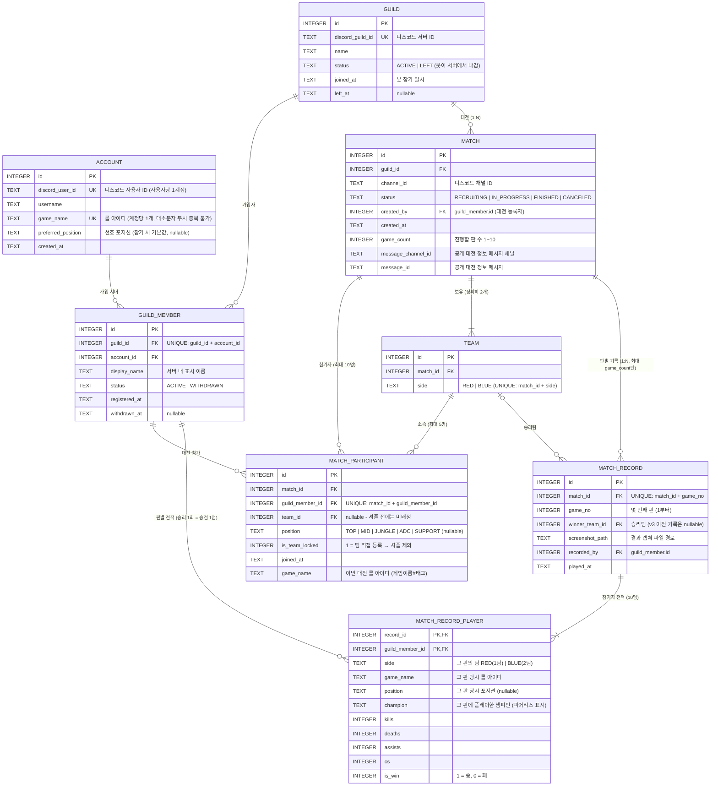

# 프로젝트 개요

디스코드 채팅방 내에서 5대5 게임 대전을 관리할 디스코드 커스텀 봇 개발

## 개발 요건

- 대전을 조율 및 관리해줄 디스코드 봇을 생성한다.
- 봇은 자동 또는 수동(입력되는 명령어)으로 작업을 수행한다.
- 구조: **계정관리 서비스**(서비스 이용 자격 관리) + **대전관리 서비스**(대전별 등록 및 팀 섞기)

### 1. 계정관리 서비스
- **계정 등록**: 계정 등록 시 **롤 아이디를 함께 등록**한다. **계정당 아이디 1개**이며, 다른 계정이 등록한 아이디는 쓸 수 없다(대소문자 무시).
- **아이디 변경**: 등록한 롤 아이디를 바꾼다. (모집 중인 대전에 참가 중이면 그 대전에도 반영)
- **선호 포지션**: 계정에 선호 포지션을 저장한다. 대전 참가/등록 시 포지션 기본값이 된다.
- **계정 탈퇴**: 계정을 탈퇴한다.

### 2. 대전관리 서비스
사용자 관리 / 팀 관리 / 개인별 승점 조회

#### 2-1. 사용자 관리
- **대전 등록**: 커맨드로 이번 대전에 참가한다.
- **대전 탈퇴**: 커맨드로 대전 참가를 철회한다.
- **포지션 선택**: 커맨드로 탑/미드/정글/원딜/서폿 중 하나를 선택한다.

#### 2-2. 팀 관리
- **팀 등록**: 커맨드로 원하는 팀을 선택한다.
- **팀 탈퇴**: 커맨드로 팀에서 탈퇴한다.
- **팀 자동셔플**: 참가자가 2명 이상이면 사용 가능하며(10명이 안 되어도 됨), 랜덤으로 팀을 섞어 정해준다. (처음 요건은 10명일 때만이었으나 변경됨)
  - 개인에게 포지션이 등록되어 있다면 포지션을 우선으로 고려한다.
  - 개인이 팀 등록을 미리 했다면 해당 인원은 셔플 대상에서 제외한다(선택한 팀 유지).

#### 2-3. 개인별 승점 조회
- 사용자별 승점을 조회할 수 있다.
- **승점 규칙: 1승당 1점, 감점 없음** (서버별로 따로 계산)

### 2-4. 전적관리 서비스
- 관리자가 전적관리 채널에서 `/전적 관리`를 입력하면, 그 채널에서 전적관리 기능(버튼 패널)을 사용할 수 있다.
- 전적은 **대전관리의 [대전 기록]으로 적재된 판별 기록**을 조회한다. 판별 기록에는 **참가자 · 팀 · 챔피언 · 킬 · 데스 · 어시 · CS · 승패**가 반드시 포함된다.
- **피어리스**: **한 대전 안에서 챔피언은 중복될 수 없다.** 이전 판에서 누구든(양 팀 모두) 사용한 챔피언은 그 대전의 다음 판에서 쓸 수 없다. (예: 3판 중 1판에 제라스를 했으면 2·3판에는 아무도 제라스 불가)
  - 챔피언은 참가자가 입력하는 것이 아니라, 판이 끝난 뒤 [대전 기록]에 적재된 기록으로 확인한다.
  - 참가자는 다음 판 전에 **대전 정보 메시지(공개)와 대전 조회**에서 `아이디(제라스 - 룰루)`(판 순서대로)와 "사용한 챔피언" 목록을 볼 수 있다. 대전별 전적, 종료 알림, CSV에도 표시된다.
- **대전별 전적 조회**: 대전을 선택하면 참가자별 전적(합계)을 보여주고, 판을 고르면 판별 상세(팀별 K/D/A · CS · 승패 + 결과 캡쳐)를 보여준다. 진행 중인 대전도 조회할 수 있다.
- **개인별 전적 조회**: 계정을 선택(디스코드 사용자 검색)하면 그 계정의 전적 요약(판 수 · 승패 · 승률 · 평균 K/D/A · KDA · 평균 CS · 승점)과 최근 10판을 보여준다.
- **전체 전적 조회**: 모든 계정의 전적 요약을 보여주고, **모든 계정의 판별 전적은 CSV 파일**로 첨부한다. (메시지 길이 제한 때문)
- 개인별/전체 전적은 **종료된 대전만** 포함한다. (승점과 같은 기준)

### 2-5. 관리자 기능 (`/관리자`, 관리자 전용)
- **`/관리자 계정정보`**: 이 서버의 모든 계정(탈퇴 포함)을 **행렬 표**로 보여준다. 열: 번호 · 이름 · 롤 아이디 · 선호 포지션 · 상태 · 판 · 승 · 패 · KDA · 승점 · 등록일. 표가 길면 앞부분만 보이고, 전체는 **CSV**로 첨부한다.
- **`/관리자 데이터적재 대전 판 이미지`**: DB의 대전 목록에서 **종료된** 대전의 그 판을 찾아 **팀 · 챔피언 · K/D/A · CS · 승패를 입력/갱신**한다. 승점은 판별 승패에서 계산되므로 함께 갱신된다.
  - 흐름: 커맨드(대전 번호는 자동완성) → 미리보기(올린 이미지 + 현재 기록 + [전적 입력] 버튼) → 입력창(승리팀 + 팀별 양식, 기존 값으로 미리 채움) → 저장
  - 이미 기록된 판은 **덮어쓰고**(그 판에 저장된 팀 기준), 기록이 없는 판은 **새로 만든다**(대전 참가자의 마지막 팀, 5:5 필요).
  - **종료(`FINISHED`)된 대전만** 고칠 수 있다. 모집 중 · 진행 중인 대전은 등록 불가(진행 중이면 관리 패널의 [대전 기록]을 쓰라고 안내), 취소된 대전도 불가. 대전 번호 자동완성에도 종료된 대전만 나온다.
  - **Gemini 자동 읽기** (`GEMINI_API_KEY`가 있을 때, `src/integrations/geminiScoreboard.js`): 이미지를 올리면 그 판의 팀 구성(1팀 1~5번, 2팀 6~10번, 입력창 양식과 같은 순서)과 함께 Gemini에 보내 10명의 챔피언 · K/D/A · CS와 **승리팀**을 JSON으로 받는다.
    - 10명 + 승리팀을 모두 읽었고 검사(피어리스 · 중복 · 팀 서명)를 통과하면 **바로 저장**하고 결과에 [수정] 버튼을 붙인다([수정] → 저장된 값으로 채운 입력창).
    - 일부를 못 읽었거나, 참가자별 승패와 승리팀이 어긋나거나, 검사에 걸리면 **저장하지 않는다.** 읽은 값을 `pending-<토큰>-read.json`에 두고 미리보기 + [전적 입력](읽은 값으로 채운 입력창)으로 관리자가 마무리한다.
    - Gemini 오류(키 · 한도 · 시간 초과 90초 등)나 키가 없으면 기존 직접 입력 흐름(미리보기 + [전적 입력])을 쓴다. png · jpg · webp만 읽는다.
  - 이미지는 저장 시 그 판의 결과 캡쳐로 바뀐다.
  - 올린 이미지는 저장 전까지 `pending-<토큰>` 파일로 대기하고, 하루가 지나면 정리된다.
  - 피어리스 · 한 판 중복 검사, 팀 구성 서명 검사를 [대전 기록]과 똑같이 한다.

### 3. 버튼 기반 상호작용 (v2, 현재 기준)
- 게임은 **리그 오브 레전드**. 사용자 설정 게임(내전)은 Riot API 전적에 남지 않으므로, **결과는 캡쳐 + 승리자 선택으로 직접 기록**한다.
- **슬래시 커맨드는 서버 관리자(Administrator 권한) 전용**이다. 일반 사용자는 버튼으로만 이용한다.
- **모든 응답은 기본적으로 본인만 볼 수 있다(ephemeral).** 모두에게 보이는 메시지는 아래 3가지뿐이다.
  - `/계정 관리` 버튼 패널 (계정관리 채널)
  - `/대전 관리` 버튼 패널 (대전관리 채널)
  - 대전 정보 메시지 (대전 등록 시 채널에 올라감, 상태/참가자 수 자동 갱신)
  - `/전적 관리` 버튼 패널 (전적관리 채널)
  - 대전 종료 알림 (판별 결과, 이번 대전 전적, 결과 캡쳐)
- **채널 분리**: 계정관리 채널, 대전관리 채널, 전적관리 채널이 따로 있다.
  - 전적관리 채널: 관리자 `/전적 관리` → 패널 [대전별 전적 조회] / [개인별 전적 조회] / [전체 전적 조회]
  - 계정관리 채널: 관리자 `/계정 관리` → 패널 [계정 등록](롤 아이디 입력) / [아이디 변경] / [선호 포지션] / [계정 탈퇴]
  - 대전관리 채널: 관리자 `/대전 관리` → 패널 [대전 등록] / [진행중인 대전 조회] (계정 버튼 없음)
  - 대전 정보 메시지와 종료 알림은 [대전 등록]을 누른 채널(대전관리 채널)에 올라간다.
  - **대전 등록**: 판 수 선택 메뉴(1~10판) → 포지션 선택(기본값 선호 포지션, 롤 아이디는 계정 것 사용) → 대전 생성 + 등록자 자동 참가 → 대전 정보 메시지(공개) + 등록자에게 관리 패널(본인만)
  - **대전 정보 메시지 버튼**: [대전 참가](포지션 선택, 기본값 선호 포지션) · [대전 탈퇴] · [대전 조회](참가자/포지션/아이디) · [포지션 등록/변경] · [팀 등록/변경] · [대전 관리]
  - **관리 패널**: [팀 랜덤 셔플](2명 이상, 시작 후에도 가능, 1팀/2팀 구성 표시) · [대전 시작](10명 + 5:5 팀 필수) · [대전 기록](결과 캡쳐 + 승리팀 + 10명의 K/D/A/CS) · [대전 종료](종료 알림 공개) · [대전 취소]
  - 대전 정보 메시지(공개)는 참가자를 **1팀 / 2팀 / 미정**으로 나눠 보여주고, 기록된 판이 있으면 참가자별 이전 판 챔피언과 "🚫 사용한 챔피언" 목록(피어리스)을 함께 보여준다.
- 승점 조회/랭킹은 관리자 커맨드(`/승점`)로 남아 있고, 개인별 승점은 전적관리의 [개인별 전적 조회]에서도 볼 수 있다.

### 확정된 운영 규칙
- **서버당 진행 중인 대전은 1개만** 허용한다. (`RECRUITING`/`IN_PROGRESS` 상태는 서버당 1개, DB의 부분 UNIQUE 인덱스로도 보장)
- 대전 상태 흐름: `RECRUITING`(모집 중) → `IN_PROGRESS`(진행 중) → `FINISHED`(종료), 언제든 `CANCELED`(취소) 가능
- 대전 하나에 **1~10판**. 판 수는 대전 등록 시 정하며, 등록한 판 수까지만 기록할 수 있다. 덜 기록하고 종료해도 된다.
- **대전 시작은 참가자 10명이 모이고 1팀 5명 · 2팀 5명으로 나뉘어 있어야** 한다. (판별 기록에 팀이 필요하기 때문) 시작 후에는 참가/탈퇴/포지션/팀 직접 변경 불가. **단, 관리자/등록자의 [팀 랜덤 셔플]은 진행 중에도 판 사이에 할 수 있다.** 판별 기록에 그 판의 팀이 저장되므로 전적은 정확히 남는다.
- [대전 기록]의 다음 판 번호는 **아직 기록되지 않은 가장 작은 판 번호**다. (데이터적재로 뒤의 판을 먼저 넣었을 수 있음)
- **대전 기록(판별)**: 결과 캡쳐 1장 + **승리팀** + **참가자 10명의 챔피언 · 킬/데스/어시/CS**를 반드시 입력한다. 승패는 승리팀으로 정해지고, 팀 · 포지션 · 롤 아이디는 그 판 당시 값으로 함께 저장된다.
  - 입력창의 팀별 칸에는 팀원 이름이 미리 채워진 양식(`1. 이름 (롤아이디) : 챔피언 0/0/0/0`)이 들어가고, `챔피언`과 숫자만 바꾸면 된다. (예: `1. 홍길동 : 제라스 5/2/10/180`) 형식이 틀리면 본인에게 안내하고, 입력한 내용을 돌려줘 다시 붙여넣을 수 있게 한다.
  - **피어리스 검사**: 이 대전의 이전 판에서 누구든 쓴 챔피언, 또는 한 판 안에서 같은 챔피언을 두 명이 쓰면 기록을 막는다(띄어쓰기/대소문자 무시). 입력창 설명에 사용 불가 챔피언을 보여준다.
  - 입력창 customId에 **팀 구성 서명**을 넣어, 입력창을 연 뒤 셔플로 팀이 바뀌면 기록을 막는다. (양식 줄 순서가 팀 구성 기준이므로)
- 팀 랜덤 셔플·대전 시작·기록·종료·취소는 **서버 관리자 또는 대전 등록자**만 할 수 있다. 그 외에는 "권한 없음".
- **롤 아이디(`게임이름#태그`)는 계정 등록 때 등록**한다. 게임이름은 글자/숫자/공백 3~16자, 태그는 특수문자 없이 3~5자. **계정당 1개, 다른 계정과 중복 불가.** 대전 등록/참가 때는 아이디를 입력하지 않고 계정의 아이디를 쓴다(참가 시점 값이 `match_participant.game_name`에 저장). 아이디가 없는 이전 계정은 [아이디 변경]으로 먼저 등록해야 참가할 수 있다.
- 포지션은 **대전마다 따로** 등록한다. 선택지는 탑/정글/미드/원딜/서폿/**미정**. **참가 입력창(대전 등록/대전 참가)에서 미리 고를 수 있고**, 기본값은 계정관리의 **선호 포지션**(`account.preferred_position`, 없으면 미정)이다. 대전에서 고른 포지션은 선호 포지션을 바꾸지 않는다. 참가 후에도 [포지션 등록/변경]으로 바꿀 수 있다.
- 팀은 **1팀 / 2팀 / 미정** (내부 값 `RED`=1팀, `BLUE`=2팀, `NULL`=미정). 참가 시 기본값은 미정이며 모집 중에는 언제든 바꿀 수 있다. 팀당 최대 5명.
  - 1팀/2팀을 직접 고르면 그 팀에 고정되어 셔플에서 제외되고(`is_team_locked = 1`), 미정으로 바꾸면 다시 셔플 대상이 된다.
- **팀 랜덤 셔플**은 관리 패널에서 **관리자 또는 대전 등록자**만 할 수 있다. 참가자가 10명이 안 되어도 **2명 이상**이면 할 수 있고, 두 팀 인원이 최대한 같게(홀수면 1명 차이) 나눈다. 결과(1팀/2팀 구성)는 누른 사람에게 보여주고, 공개 대전 정보 메시지에도 반영된다.
- **승점 = 판 1승당 1점, 감점 없음.** 종료(`FINISHED`)된 대전의 기록만 반영, 서버별로 계산.
- 계정 탈퇴는 soft delete (기록 보존, 재등록 시 이어짐).
- 참가자 변경(대전 참가/탈퇴, 팀 등록/탈퇴)이 생기면 기존 셔플 결과(직접 등록자 제외)는 초기화되므로 다시 셔플해야 한다.

## 기술 스택

- **Runtime**: Node.js
- **Discord 라이브러리**: discord.js
- **DB**: SQLite

## 데이터베이스 설계 (RDB)

### 설계 원칙

- DB는 **SQLite 파일 1개**를 모든 디스코드 서버가 함께 쓰고, **서버(guild) 단위로 데이터를 논리적으로 분리**한다.
- 기본 흐름: **서버(guild) - 계정(account) - 대전(match) - 팀(team) - 대전기록(match_record)**
- **계정은 디스코드 사용자당 1개** (`account.discord_user_id` UNIQUE)
- **서버 ↔ 계정 = N:M**: 한 사람이 여러 서버에 가입할 수 있다. 연결 테이블은 **서버회원(guild_member)**이며, `UNIQUE(guild_id, account_id)`로 서버당 1회만 가입할 수 있다.
  - 커맨드의 "계정 등록/탈퇴"는 **해당 서버의 guild_member 등록/탈퇴**를 뜻한다. `account`는 처음 등록할 때 자동으로 만들어진다.
  - 그래서 A 서버에서 탈퇴해도 B 서버의 가입과 승점에는 영향이 없다.
- **서버 ↔ 대전 = 1:N**: 대전은 반드시 하나의 서버에 속하고, 서버마다 대전을 여러 개 만들 수 있다.
- 대전마다 팀은 **2개**, 기본값은 **레드팀(RED) / 블루팀(BLUE)** (`UNIQUE(match_id, side)`)
- **대전 ↔ 서버회원 = N:M**이므로 **대전참가자(match_participant)**로 풀어낸다. 참가자는 `guild_member`를 참조하므로 **해당 서버에 가입한 사람만** 대전에 참가할 수 있다.
- **대전 ↔ 대전기록 = 1:N** (판별 기록, `UNIQUE(match_id, game_no)`). 판마다 결과 캡쳐와 승리팀을 저장한다.
- **대전기록 ↔ 판별 참가자 전적 = 1:N** (`match_record_player`, 판마다 10행). 참가자 · 팀 · K/D/A · CS · 승패를 사람 단위로 저장한다. 승점과 전적은 모두 이 테이블에서 계산한다.

### ERD



### 테이블 설명

| 테이블 | 역할 | 주요 제약 |
|---|---|---|
| `guild` | 봇이 참가한 디스코드 서버 | `discord_guild_id` UNIQUE. 봇이 서버에 들어올 때(`guildCreate` 이벤트) 자동 생성하고, 나갈 때(`guildDelete`) `status = LEFT`로 바꾼다 |
| `account` | 디스코드 사용자 (전역) | `discord_user_id` UNIQUE. 사용자당 1개. `game_name`(롤 아이디)은 `lower(game_name)` 부분 UNIQUE 인덱스로 계정 간 중복 불가 |
| `guild_member` | 서버별 가입 정보 (계정 등록/탈퇴) | `UNIQUE(guild_id, account_id)`. 탈퇴하면 `status = WITHDRAWN`으로 바꾸는 soft delete (기록 보존용). 다시 가입하면 같은 행을 `ACTIVE`로 되돌린다 |
| `match` | 대전 1건 | `guild_id` NOT NULL. `status`로 모집 → 진행 → 종료 상태를 관리. `game_count` 1~10, 공개 메시지 위치 저장 |
| `team` | 대전의 팀 (RED/BLUE) | 대전을 만들 때 2개를 자동 생성. `UNIQUE(match_id, side)`, `side IN ('RED','BLUE')` |
| `match_participant` | 대전 참가자 (대전 등록/탈퇴, 포지션 선택, 팀 등록/탈퇴) | `UNIQUE(match_id, guild_member_id)`. 대전당 10명, 팀당 5명 제한, 참가자가 대전과 같은 서버 회원인지는 애플리케이션에서 검증 |
| `match_record` | 판별 기록 (결과 캡쳐, 승리팀) | `UNIQUE(match_id, game_no)`. `game_no`는 1부터 `match.game_count`까지 |
| `match_record_player` | 판별 참가자 전적 (팀 · 챔피언 · K/D/A · CS · 승패) | PK `(record_id, guild_member_id)`. 판마다 10명. K/D/A/CS는 0 이상(이전 버전 기록은 NULL). `is_win = 1` 1행 = 승점 1점 |

### 기능 ↔ 테이블 매핑

- **봇 서버 참가 / 퇴장** → `guild` INSERT(또는 `ACTIVE`로 복구) / `status = LEFT`
- **계정 등록** → 롤 아이디 중복 확인 → `account`가 없으면 INSERT(`game_name`), 있으면 `game_name` UPDATE → `guild_member` INSERT(또는 `ACTIVE`로 복구)
- **아이디 변경 / 선호 포지션** → `account.game_name` / `account.preferred_position` UPDATE
- **계정 탈퇴** → 해당 서버의 `guild_member.status = WITHDRAWN` (다른 서버 가입에는 영향 없음)
- **대전 등록(생성)** → `match` INSERT(`game_count`) + `team` 2개 + 등록자 `match_participant` INSERT → 공개 메시지 위치 `match.message_*` UPDATE
- **대전 참가 / 탈퇴** → `match_participant` INSERT(`game_name` = 계정 아이디, `position` = 고른 값 또는 선호 포지션) / DELETE (`ACTIVE` 상태의 guild_member만 가능)
- **포지션 선택** → `match_participant.position` UPDATE
- **팀 등록 / 탈퇴** → `match_participant.team_id` 설정 + `is_team_locked = 1` / `team_id = NULL` + `is_team_locked = 0`
- **팀 자동셔플** → 참가자가 2명 이상인지 확인 → `is_team_locked = 0`인 참가자만 대상으로, 포지션이 겹치지 않도록 우선 배치한 뒤 나머지를 랜덤으로 `team_id` 배정
- **대전 기록** → `match_record` INSERT(`game_no`, 캡쳐 경로, 승리팀) + `match_record_player` 10행 INSERT(팀, 롤 아이디, 포지션, 챔피언, K/D/A/CS, 승패)
- **피어리스 표시** → `match_record_player.champion`을 `game_no` 순으로 모아 `아이디(챔피언1 - 챔피언2)`
- **대전 시작 / 종료 / 취소** → `match.status` UPDATE (`IN_PROGRESS` / `FINISHED` / `CANCELED`)
- **개인별 승점 조회** → 종료된 대전의 `match_record_player` 행 수 = 판 수, `is_win` 합 = 승리 수 = 승점. **서버별로** 계산
- **전적 조회** → `match_record_player` + `match_record` + `match` JOIN. 대전별은 진행 중 포함, 개인별/전체는 종료된 대전만

### 구현 시 주의

- 모든 조회와 변경은 **현재 커맨드가 들어온 서버(guild) 범위**로 한정한다. 다른 서버의 데이터가 섞이지 않도록 서비스 계층에서 `guild_id` 조건을 강제한다.

### 마이그레이션 (`src/db/migrations.js`)

- `PRAGMA user_version`으로 스키마 버전을 관리한다. 새 DB는 `schema.sql`(최신 모양)로 만들고, 기존 DB는 버전별 마이그레이션을 순서대로 적용한다.
- **v2**: 대전기록 1:1 → 1:N 전환, `match_record_winner` 추가, 판 수·공개 메시지·롤 아이디 컬럼 추가. 기존 기록은 1판으로 옮기고 승리팀 인원을 승리자로 옮겨 **기존 승점을 유지**한다.
- **v3**: `match_record_winner` → `match_record_player`(팀 · K/D/A · CS · 승패). 기존 기록은 그 대전 참가자 전원을 옮기고 승리자 목록으로 승패를 채운다(K/D/A/CS는 NULL). 기존 승점은 유지된다.
- **v4**: `match_record_player.champion`(피어리스), `account.last_position`(참가 입력창 포지션 기본값) 추가.
- **v5**: `account.last_game_name` → `game_name`(계정당 롤 아이디 1개, 중복 불가 인덱스), `last_position` → `preferred_position`(선호 포지션). 같은 아이디를 여러 계정이 쓰고 있었다면 먼저 만든 계정만 남기고 나머지는 비운다.
- 스키마를 바꿀 때는 `schema.sql`(최신 모양)과 새 마이그레이션 버전을 **함께** 추가한다.

## 버튼 / 선택 메뉴 / 입력창 (`src/interactions/`)

customId 규칙: `<action>|<인자...>` (`src/interactions/ids.js`). 대전 관련 버튼에는 대전 ID를 넣어 끝난 대전의 옛 버튼을 막는다.

| 위치 | 컴포넌트 | 동작 | 권한 | 응답 |
|---|---|---|---|---|
| 계정 패널 | [계정 등록] → 롤 아이디 입력창 | 서버 회원 등록 + 계정 롤 아이디 등록 (중복 불가) | 누구나 | 본인 |
| 계정 패널 | [아이디 변경] → 롤 아이디 입력창 | 계정 롤 아이디 변경 | 등록 회원 | 본인 |
| 계정 패널 | [선호 포지션] → 포지션 선택 메뉴 | 대전 참가 시 포지션 기본값 저장 | 등록 회원 | 본인 |
| 계정 패널 | [계정 탈퇴] | 서버 회원 탈퇴 | 누구나 | 본인 |
| 대전 패널 | [대전 등록] → 판 수 선택 메뉴 → 포지션 입력창(기본값 선호 포지션) | 대전 생성 + 자동 참가, 공개 대전 정보 메시지 게시 | 계정 등록자 | 관리 패널(본인) |
| 대전 패널 | [진행중인 대전 조회] | 대전 현황 + 참가 버튼 + 메시지 링크 | 누구나 | 본인 |
| 대전 정보 | [대전 참가] → 포지션 입력창(기본값 선호 포지션) | 참가 (10명 제한, 계정 롤 아이디 사용) | 계정 등록자 | 본인 |
| 대전 정보 | [대전 탈퇴] | 참가 철회 | 참가자 | 본인 |
| 대전 정보 | [대전 조회] | 참가자 · 포지션 · 롤 아이디(이전 판 챔피언) · 사용한 챔피언(피어리스) · 기록 현황 | 누구나 | 본인 |
| 대전 정보 | [포지션 등록/변경] → 포지션 선택 메뉴 (탑/정글/미드/원딜/서폿/미정) | 이번 대전 포지션 | 참가자 | 본인 |
| 대전 정보 | [팀 등록/변경] → 팀 선택 메뉴 (1팀/2팀/미정) | 팀 고정 또는 미정으로 되돌리기 | 참가자 | 본인 |
| 대전 정보 | [대전 관리] | 관리 패널 열기 | 관리자 / 등록자 (그 외 "권한 없음") | 본인 |
| 관리 패널 | [팀 랜덤 셔플] | 2명 이상이면 미정/셔플 인원을 1팀·2팀으로 배정(인원 균등), 팀 구성 표시. 진행 중에도 가능 | 관리자 / 등록자 | 본인 (패널 갱신) |
| 관리 패널 | [대전 시작] | 10명 + 5:5 팀일 때 진행 중으로 | 관리자 / 등록자 | 본인 (패널 갱신) |
| 관리 패널 | [대전 기록] → 입력창(캡쳐 업로드 + 승리팀 선택 + 1팀/2팀 챔피언 · K/D/A/CS 양식) | 판별 기록, 캡쳐는 `RECORDS_DIR`에 저장 | 관리자 / 등록자 | 본인 |
| 관리 패널 | [대전 종료] | 종료 + **공개 종료 알림**(판별 결과, 승점, 캡쳐 첨부) | 관리자 / 등록자 | 본인 + 공개 |
| 관리 패널 | [대전 취소] | 취소 (승점 미반영) | 관리자 / 등록자 | 본인 |
| 전적 패널 | [대전별 전적 조회] → 대전 선택 메뉴 → 판 선택 메뉴 | 참가자별 합계 / 판별 상세 + 캡쳐 | 누구나 | 본인 |
| 전적 패널 | [개인별 전적 조회] → 계정(사용자) 선택 메뉴 | 요약 + 최근 10판 | 누구나 | 본인 |
| 전적 패널 | [전체 전적 조회] | 계정별 요약 + 판별 전적 CSV 첨부 | 누구나 | 본인 |
| 데이터적재 미리보기 | [전적 입력] → 입력창(승리팀 + 팀별 챔피언 · K/D/A · CS, Gemini가 읽은 값 또는 기존 값 채움) | 판 기록 저장/덮어쓰기 + 캡쳐 교체 | 관리자 | 본인 |
| 데이터적재 자동 저장 결과 | [수정] → 입력창(저장된 값 채움, customId 토큰 `-`) | 판 기록 덮어쓰기 (캡쳐는 그대로) | 관리자 | 본인 |

자동 처리: 봇이 켜질 때 참가 중인 서버를 동기화하고, 서버에 들어오거나 나갈 때 `guild` 상태를 갱신한다. 참가/탈퇴/시작/기록/종료 때마다 공개 대전 정보 메시지를 다시 그린다.

## 슬래시 커맨드 (관리자 전용)

모든 커맨드에 `default_member_permissions = Administrator`를 걸고, 실행 시에도 관리자 권한을 다시 확인한다. 응답은 `/계정 관리`, `/대전 관리`, `/전적 관리`를 빼고 모두 본인만 볼 수 있다.

| 커맨드 | 설명 |
|---|---|
| `/계정 관리` | 이 채널에 계정 패널 게시 (공개) - 계정관리 채널용 |
| `/대전 관리` | 이 채널에 대전 패널 게시 (공개) - 대전관리 채널용 |
| `/전적 관리` | 이 채널에 전적 패널 게시 (공개) - 전적관리 채널용 |
| `/대전 참가` · `/대전 탈퇴` · `/대전 포지션` | 관리자 본인의 참가(계정 아이디 · 선호 포지션)/탈퇴/포지션 |
| `/대전 참가자` · `/대전 현황` | 참가자 목록, 팀 구성 + 판별 기록 |
| `/대전 시작` · `/대전 종료` · `/대전 취소` | 관리 패널과 동일 |
| `/계정 등록 <아이디>` · `/계정 탈퇴` | 관리자 본인 계정 (롤 아이디 필수) |
| `/팀 등록 <1팀/2팀>` · `/팀 탈퇴` · `/팀 셔플` | 관리자 본인 팀 선택 / 셔플 (버튼과 동일) |
| `/승점 조회 [사용자]` · `/승점 랭킹` | 승점 |
| `/관리자 계정정보` | 모든 계정 정보 행렬 표 + CSV |
| `/관리자 데이터적재 <대전> <판> <이미지>` | 종료된 대전의 한 판을 찾아 K/D/A · 승패(승점) 입력/갱신 (Gemini 키가 있으면 이미지를 읽어 자동 저장) |

`/대전 결과`(팀 기준 기록)는 K/D/A/CS를 받을 수 없어 v3에서 제거했다. 판 기록은 관리 패널의 [대전 기록]으로만 한다.

## 결과 캡쳐 → 입력 양식 변환 도구 (`scripts/gemini-scoreboard.mjs`, 선택)

- 봇과 **별개인 PC용 CLI**다. 봇의 `/관리자 데이터적재`는 같은 일을 봇 안에서 한다(위 Gemini 자동 읽기). [대전 기록] 입력창에 붙여넣을 텍스트가 필요할 때 쓴다.
- `npm run scoreboard -- <이미지> [양식 파일]` (양식은 파일 또는 표준 입력): 결과 이미지 + 입력창 양식을 Gemini(`@google/genai`, 기본 `gemini-flash-latest`)에 보내고, 채워진 양식 텍스트를 출력한다. 관리자가 확인 후 입력창에 붙여넣는다.
- Gemini에게는 참가자 번호별 `champion / kills / deaths / assists / cs`만 **JSON(responseJsonSchema)**으로 받고, 줄 모양은 스크립트가 양식 그대로 만든다(형식 오류 방지). 못 찾은 줄은 `챔피언 0/0/0/0`으로 두고 경고한다.
- 4번째 값은 기본 CS(봇 입력창 형식). `--fourth kda`는 (킬+어시)/데스 소수 첫째 자리.
- `GEMINI_API_KEY`(`.env`), 선택 `GEMINI_MODEL`. 봇도 같은 값을 쓴다(`config.geminiApiKey` / `geminiModel`).

## 로그 (`src/utils/commandLogger.js`)

- 모든 슬래시 커맨드와 버튼/선택 메뉴/입력창 실행을 **서버별 텍스트 파일**에 한 줄씩 남긴다: `logs/<디스코드 서버 ID>.log` (서버 밖 DM은 `logs/direct-message.log`)
- 형식: `[등록날짜] 등록 커맨드 | 등록자 | 성공/실패 | 결과 메시지`
  ```
  [2026-11-20 15:30:12] /대전 포지션 포지션:MID | 홍길동 (hong, 123456789) | 성공 | 🎯 <@123456789> 님의 포지션: **미드**
  ```
  - 등록날짜: `LOG_TIMEZONE` 기준 (기본 Asia/Seoul)
  - 등록 커맨드: 서브커맨드와 옵션까지 포함. 버튼은 `[버튼] 대전 참가`, 선택은 `[선택] 포지션 선택: MID`, 입력은 `[입력] 대전 참가 - 롤 아이디 입력: Hide on bush#KR1`
  - 등록자: 서버 표시 이름 (사용자명, 디스코드 ID)
  - 결과 메시지: 봇이 보낸 응답 (임베드는 `[임베드] 제목 설명`으로 요약, 줄바꿈은 ` / `로 치환)
- 로그 기록에 실패해도 커맨드 처리에는 영향을 주지 않는다. 로그 폴더는 `LOG_DIR`로 바꿀 수 있고 git에는 올리지 않는다.

## 팀 자동셔플 알고리즘 (`src/services/shuffle.js`)

1. 팀 직접 등록자(`is_team_locked = 1`)는 등록한 팀에 고정한다.
2. 나머지 인원을 나눌 때 팀당 5명을 넘지 않으면서 **두 팀 인원 차이가 가장 작은** 배분만 후보로 둔다. (10명이면 5:5, 7명이면 4:3 또는 3:4)
   그 배분으로 만들 수 있는 **모든 조합**을 만든다 (최대 C(10,5) = 252개).
3. 각 조합마다 팀 안에서 포지션이 겹치는 수를 계산해 (고정 인원 포함, 포지션 미선택자는 제외) 겹침이 **가장 적은** 조합만 남긴다.
4. 남은 후보 중 하나를 **무작위**로 고른다.

## 프로젝트 구조

```
src/
  index.js              # 봇 진입점 (이벤트, 커맨드 라우팅, 오류 응답)
  deploy-commands.js    # 슬래시 커맨드 등록 스크립트
  config.js             # 환경 변수 (.env)
  constants.js          # 인원, 포지션, 팀, 상태, 승점 상수
  db/schema.sql         # SQLite 스키마 (최신 모양)
  db/migrations.js      # 기존 DB 마이그레이션 (PRAGMA user_version)
  db/index.js           # DB 열기 + 스키마/마이그레이션 적용
  repositories/         # 테이블별 쿼리 (SQL은 이 폴더에만 둔다)
    index.js            # createRepositories(db) + transaction(fn)
    guildRepository.js              # guild
    accountRepository.js            # account
    guildMemberRepository.js        # guild_member (+ 서버 승점 랭킹)
    matchRepository.js              # match
    teamRepository.js               # team
    matchParticipantRepository.js   # match_participant
    matchRecordRepository.js        # match_record (판별 기록)
    matchRecordPlayerRepository.js  # match_record_player (판별 참가자 전적 + 전적/승점 집계)
  services/             # 비즈니스 로직 (Repository만 호출, 디스코드와 독립, 테스트 대상)
    guildService.js     # 서버 등록/퇴장
    accountService.js   # 계정관리 (등록/아이디 변경/선호 포지션/탈퇴)
    validation.js       # 롤 아이디 · 포지션 값 검사
    matchService.js     # 대전관리 - 대전, 사용자 관리
    teamService.js      # 대전관리 - 팀 관리
    shuffle.js          # 팀 자동셔플 알고리즘 (순수 함수)
    pointService.js     # 대전관리 - 승점 조회
    recordService.js    # 전적관리 - 대전별/개인별/전체 전적 조회 (요약 계산)
    adminService.js     # 관리자 - 계정정보, 데이터적재(판 찾기 · 기록 덮어쓰기)
    statInput.js        # 대전 기록 입력창의 챔피언 · K/D/A/CS 양식 만들기/읽기 (순수 함수)
  interactions/         # 버튼/선택 메뉴/입력창
    router.js           # InteractionCreate 처리 (권한, 나만 보기 기본값, 오류 응답, 로그)
    handlers.js         # customId action별 처리
    views.js            # 계정/대전 패널, 대전 정보 메시지, 관리 패널, 입력창, 종료 알림 화면
    statsViews.js       # 전적 패널, 대전별/개인별/전체 전적 화면, CSV
    adminViews.js       # 관리자 계정정보 표/CSV, 데이터적재 미리보기/입력창/결과
    matchMessage.js     # 공개 대전 정보 메시지 게시/갱신, 종료 알림 게시
    ids.js              # customId 규칙 + 로그용 이름
  commands/             # 슬래시 커맨드 정의 + 응답 (관리자 전용)
  integrations/
    geminiScoreboard.js # 데이터적재 이미지 → 10명 챔피언 · K/D/A · CS + 승리팀 (Gemini, 키 없으면 꺼짐)
  utils/                # UserError, Embed 포맷, 로그, 결과 캡쳐 저장(+ 대기 중 읽은 값), 텍스트 표(한글 폭 맞춤)
data/                   # bot.sqlite, records/<서버 ID>/ 결과 캡쳐 (git 제외)
logs/                   # 서버별 로그 (<서버 ID>.log, git 제외)
scripts/gemini-scoreboard.mjs # 결과 캡쳐 → 입력 양식 텍스트 (Gemini CLI, 선택)
test/                   # node:test 기반 테스트 (npm test)
```

## 개발 규칙

- 계층 구조: `commands/`, `interactions/` → `services/` → `repositories/` → DB
  - `commands/`, `interactions/`: 입력 파싱과 응답 표시만 담당한다.
  - `services/`: 비즈니스 로직. **DB에 직접 쿼리하지 않고 Repository만 호출한다.**
  - `repositories/`: **테이블별 파일**(`<테이블>Repository.js`)에 SQL을 둔다. 여러 테이블을 JOIN하는 조회는 결과의 기준이 되는 테이블의 Repository에 둔다.
- 사용자에게 보여줄 오류는 `UserError`로 던진다. 처리기(`router.js`)에서 본인에게만 보이는(ephemeral) 메시지로 표시한다.
- 응답은 `interaction.reply(...)`를 그대로 쓰면 자동으로 본인만 보기가 된다. 모두에게 보여야 하면 payload에 `public: true`를 넣거나 `channel.send`를 쓴다. (요건에 "모두 볼 수 있다"가 있을 때만)
- 버튼/입력창 customId는 `ids.js`의 `ACTIONS` + `buildId`로만 만들고, 대전 관련 버튼에는 대전 ID를 넣는다.
- **디스코드는 상호작용에 3초 안에 첫 응답을 받아야 한다.** 늦으면 `Unknown interaction(10062)` 오류가 나고 사용자는 응답을 못 받는다.
  - 공개 메시지 갱신(`refreshMatchMessage`)처럼 응답 내용과 상관없는 네트워크 작업은 **응답을 보낸 뒤에** 한다.
  - 응답 내용이 네트워크 작업 결과에 달려 있으면(공개 메시지 게시, 종료 알림, 캡쳐 다운로드) **`deferReply`/`deferUpdate`로 먼저 예약**하고 끝난 뒤 `editReply` 한다.
- 상태를 바꾸는 서비스 함수는 `repos.transaction(fn)`으로 감싼다.
- 모든 조회와 변경은 현재 서버(`guild.id`) 범위로 한정한다.
- 변경 후 `npm test`로 테스트를 확인한다.
